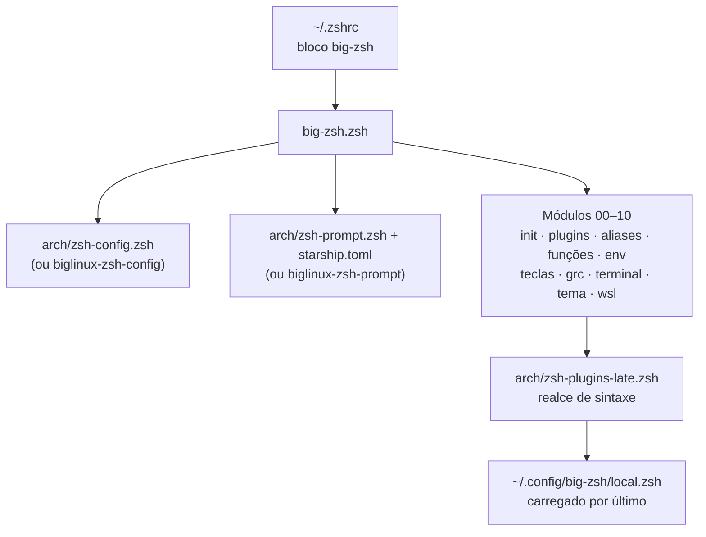

<!-- markdownlint-disable MD033 MD041 -->
<div align="center">

# 🐧 WSL Arch Zsh

**Zsh no Arch Linux do WSL, com a identidade visual do Arch.**

Uma camada pessoal e opcional que acrescenta prompt, plugins, atalhos e integração com o Windows ao Zsh,<br>
preservando o Bash, os comandos tradicionais e o seu `.bashrc`.

<br>

[](LICENSE)
[](https://github.com/BrunodosSantosVaz/wsl-arch-zsh/commits/main)
[](https://github.com/BrunodosSantosVaz/wsl-arch-zsh/stargazers)
<br>
[](#-compatibilidade)
[](#-integração-com-o-windows)
[](https://www.zsh.org/)
[](arch/starship.toml)
[](install-deps.sh)
[](#-desinstalação)

<br>

<a href="#-instalação"></a>
<a href="#-o-que-é-adicionado"></a>
<a href="#-identidade-visual-arch"></a>
<a href="COMPATIBILITY.md"></a>

</div>

<!-- Captura de tela: adicione uma imagem real do terminal em docs/terminal.png e descomente.
<p align="center">
  
</p>
-->

<br>

> [!NOTE]
> Adaptação para **Arch Linux no WSL** do [big-zsh](https://github.com/BrunodosSantosVaz/big-zsh), que é direcionado ao BigLinux. O que era emprestado do BigLinux (prompt, plugins, título da janela) ganhou uma camada própria em `arch/`, as cores seguem a paleta do Arch e há integração com o Windows. O BigLinux continua suportado. Projeto comunitário, sem vínculo oficial com o Arch Linux.

<details>
<summary><b>Sumário</b></summary>

- [Princípios](#-princípios)
- [Compatibilidade](#-compatibilidade)
- [Instalação](#-instalação)
- [O que é adicionado](#-o-que-é-adicionado)
- [Identidade visual Arch](#-identidade-visual-arch)
- [Integração com o Windows](#-integração-com-o-windows)
- [Como funciona](#-como-funciona)
- [Configuração](#-configuração)
- [Desinstalação](#-desinstalação)
- [Segurança e privacidade](#-segurança-e-privacidade)
- [Contribuindo](#-contribuindo)
- [Licença e marcas](#-licença-e-marcas)

</details>

## 🧭 Princípios

<table>
<tr>
<td width="33%" valign="top">

### 🎨 Visual Arch
Prompt, realce de sintaxe, `fzf`, `eza`, `less` e `grep` na paleta do Arch, com o azul `#1793D1` como cor principal.

</td>
<td width="33%" valign="top">

### 🛡️ Preserva o tradicional
`ls`, `cat`, `grep`, `find`, `du`, `df` e `ps` mantêm o comportamento de sempre. O Bash e o `.bashrc` ficam intactos.

</td>
<td width="33%" valign="top">

### ↩️ Reversível
Cria backup antes de alterar o `.zshrc` e pode ser removido sem desfazer nada do sistema.

</td>
</tr>
</table>

- Ferramentas modernas entram **pelos próprios nomes** e por atalhos opcionais.
- Zsh e Bash são shells diferentes, então não existe equivalência literal para toda construção. O Bash original continua sempre disponível com `bash` ou `bash-native`.

## 🐧 Compatibilidade

Feito para o **Arch Linux no WSL 2**. Funciona também em Arch nativo e no BigLinux.

| Sistema | Base usada | |
|---|---|:-:|
| Arch Linux (WSL ou nativo) | camada própria em `arch/` | ✅ |
| BigLinux | arquivos oficiais em `/usr/share/zsh/biglinux-zsh-*` | ✅ |
| Outras distribuições | o instalador encerra sem modificar nada | ➖ |

| Permanece intacto | |
|---|:-:|
| Bash, `~/.bashrc` e `/etc/bash.bashrc` | ✅ |
| Comandos tradicionais e suas opções | ✅ |
| Gerenciador de pacotes e atualizações do sistema | ✅ |
| Scripts com shebang Bash | ✅ continuam usando Bash |

O instalador valida `ID=arch` ou `ID=biglinux` em `/etc/os-release`. Veja [COMPATIBILITY.md](COMPATIBILITY.md).

## 🚀 Instalação

Revise os scripts antes de executá-los. O instalador usa `pacman` para dependências oficiais e nunca recebe senha por argumento (fora do root, pede `sudo` direto no terminal).

```bash
git clone https://github.com/BrunodosSantosVaz/wsl-arch-zsh.git ~/wsl-arch-zsh
cd ~/wsl-arch-zsh
./install-deps.sh
```

O `install-deps.sh` instala os pacotes que faltam e, no fim, chama o `setup-zshrc.sh`, que acrescenta o bloco ao `.zshrc` com backup. Teste uma nova sessão:

```bash
zsh
```

Se gostar, torne o Zsh o shell padrão (opcional, o Bash continua instalado):

```bash
chsh -s "$(command -v zsh)"
```

> [!TIP]
> Para os ícones do prompt e do `eza`, use uma [Nerd Font](https://www.nerdfonts.com/) no Windows Terminal (Configurações → Perfis → Aparência → Fonte).

<details>
<summary><b>Pacotes instalados se estiverem faltando</b></summary>

`zsh` · `eza` · `bat` · `ripgrep` · `fd` · `dust` · `duf` · `procs` · `hyperfine` · `fzf` · `zoxide` · `git-delta` · `lazygit` · `libqalculate` · `lsof` · `unzip` · `p7zip` · `mise` · `grc`

No Arch também: `starship` · `zsh-autosuggestions` · `zsh-syntax-highlighting` · `zsh-completions` · `zsh-history-substring-search`.

Alguns desses pacotes (`hyperfine`, `git-delta` e `lazygit`) só são instalados, sem atalhos próprios. Para `h` funcionar com comandos internos do Zsh, instale também `man-db`.

Todos vêm dos repositórios oficiais do `pacman`. Nada é baixado por `curl | sh`.

</details>

## ✨ O que é adicionado

### Ferramentas modernas, com nomes próprios

| Atalho | Ferramenta | Comando tradicional preservado |
|---|---|---|
| `l` · `ll` · `la` · `lt` | [eza](https://github.com/eza-community/eza) | `ls` |
| `rg` | [ripgrep](https://github.com/BurntSushi/ripgrep) | `grep` |
| `fd` | [fd](https://github.com/sharkdp/fd) | `find` |
| `dust` | [dust](https://github.com/bootandy/dust) | `du` |
| `duf` | [duf](https://github.com/muesli/duf) | `df` |
| `procs` | [procs](https://github.com/dalance/procs) | `ps` |
| `bat` | [bat](https://github.com/sharkdp/bat) | `cat` |

### Git

| Atalho | Comando |
|---|---|
| `g` | `git` |
| `gs` | `git status -sb` |
| `ga` | `git add` |
| `gc` | `git commit` |
| `gp` | `git push` |
| `gd` | `git diff` |
| `gl` | `git log --oneline --graph --decorate` |

### Navegação e shell

| Atalho | O que faz |
|---|---|
| `..` · `...` · `....` | Sobe um, dois ou três diretórios |
| `z` | Pula para diretórios frequentes com [zoxide](https://github.com/ajeetdsouza/zoxide) |
| `bash-native` | Abre uma sessão Bash de login (`exec bash -l`) |
| `reload-zsh` | Recarrega o Zsh (`exec zsh`) |
| <kbd>↑</kbd> <kbd>↓</kbd> | Busca no histórico pelo que já foi digitado |
| <kbd>Ctrl</kbd>+<kbd>X</kbd> <kbd>Ctrl</kbd>+<kbd>E</kbd> | Edita a linha de comando no `$EDITOR` |

### Funções

| Função | Uso | O que faz |
|---|---|---|
| `mkcd` | `mkcd DIRETÓRIO` | Cria o diretório e entra nele |
| `backup` | `backup ARQUIVO` | Copia com sufixo `.backup-AAAAMMDD-HHMMSS` |
| `extract` | `extract ARQUIVO` | Extrai `tar`, `gz`, `bz2`, `xz`, `zip`, `7z` e `rar` |
| `killport` | `killport PORTA` | Encerra o processo escutando na porta TCP (usa `lsof`) |
| `h` | `h COMANDO` | Mostra a ajuda do comando com destaque do `bat` |
| `=` | `= 2+2` | Calculadora com `qalc` |

### Plugins e integrações

- **[zsh-autosuggestions](https://github.com/zsh-users/zsh-autosuggestions)**: sugere o comando enquanto você digita, a partir do histórico.
- **[zsh-syntax-highlighting](https://github.com/zsh-users/zsh-syntax-highlighting)**: colore o comando na hora, vermelho quando não existe.
- **[zsh-completions](https://github.com/zsh-users/zsh-completions)**: definições de completion extras, com menu de seleção.
- **[fzf](https://github.com/junegunn/fzf)**: atalhos de teclado e completions.
- **[mise](https://mise.jdx.dev/)**: ativado quando instalado.
- **Histórico** com 50 mil entradas, compartilhado entre sessões, que descarta duplicatas antigas primeiro e ignora comandos iniciados por espaço.
- **Completion** sem diferenciar maiúsculas e minúsculas.
- **`~/.local/bin` e `~/bin`** acrescentados ao `PATH`.
- **[grc](https://github.com/garabik/grc)** (ou grc-rs) colorindo `ping`, `traceroute`, `ip`, `ss` e `diff`, só com `BIG_ZSH_ENABLE_GRC=1`.

## 🎨 Identidade visual Arch

| Cor | Hex | Onde aparece |
|---|---|---|
| Arch blue | `#1793D1` | Prompt, comandos, diretórios, `fzf`, `grep`, `less` |
| Azul claro | `#5EC4F5` | Aliases, branch do Git, caminhos, sugestões de destaque |
| Azul escuro | `#0B6FA4` | Fundo do usuário e do host no prompt |
| Cinza | `#8A9BA8` | Duração, status do Git, datas no `eza` |
| Vermelho | `#d1393d` | Erros, comando desconhecido, usuário root |

O prompt é um [Starship](https://starship.rs/) configurado em [`arch/starship.toml`](arch/starship.toml), com o logo do Arch, usuário, host, diretório, branch e status do Git, versão de Node, Python, Rust e Go, e tempo de comandos longos. O resto das cores está em [`09-theme.zsh`](09-theme.zsh).

## 🪟 Integração com o Windows

Ativa somente dentro do WSL (módulo [`10-wsl.zsh`](10-wsl.zsh)).

| Atalho | O que faz |
|---|---|
| `open` | Abre com o Explorer do Windows (`explorer.exe`) |
| `winopen [CAMINHO]` | Abre o arquivo ou pasta (padrão: a atual) no app padrão do Windows |
| `winhome` | Vai para a pasta do usuário no Windows |
| `clip` · `pbcopy` | Copia a entrada para a área de transferência do Windows |
| `pbpaste` | Cola a área de transferência do Windows |

O Windows Terminal também recebe o diretório atual (OSC 9;9), então duplicar a aba ou dividir o painel abre no mesmo lugar.

## ⚙️ Como funciona



O ponto de entrada carrega a base (os arquivos do BigLinux, se existirem; senão a camada Arch em `arch/`), depois os módulos numerados em ordem, o realce de sintaxe (que precisa vir por último) e, por fim, a sua configuração pessoal.

<details>
<summary><b>Estrutura do repositório</b></summary>

```
wsl-arch-zsh/
├── big-zsh.zsh          Ponto de entrada (source no .zshrc)
├── 00-init.zsh          Opções de histórico, completion e fzf
├── 01-plugins.zsh       mise e zoxide
├── 02-mise.zsh          Módulo de compatibilidade
├── 03-aliases.zsh       Navegação, Git e eza
├── 04-functions.zsh     mkcd, backup, killport, extract, h e =
├── 05-env.zsh           PATH, EDITOR e VISUAL
├── 06-keybindings.zsh   Edição estilo Emacs
├── 07-grc.zsh           Cores do grc (opcional)
├── 08-terminal.zsh      Integração do terminal
├── 09-theme.zsh         Cores Arch (fzf, less, eza, grep)
├── 10-wsl.zsh           Integração com o Windows
├── arch/
│   ├── zsh-config.zsh        Histórico, completion, título e plugins
│   ├── zsh-prompt.zsh        Carrega o Starship
│   ├── starship.toml         Prompt na paleta Arch
│   └── zsh-plugins-late.zsh  Realce de sintaxe (carregado por último)
├── install-deps.sh      Instalador principal
├── setup-zshrc.sh       Adiciona o bloco ao .zshrc com backup
├── uninstall.sh         Remove o bloco do .zshrc com backup
└── test-setup.sh        Verificações de sintaxe e carregamento
```

</details>

## 🔧 Configuração

O instalador acrescenta ao `.zshrc` apenas um bloco identificado:

```zsh
# >>> big-zsh >>>
source "/caminho/para/wsl-arch-zsh/big-zsh.zsh"
# <<< big-zsh <<<
```

Configurações pessoais ficam em `~/.config/big-zsh/local.zsh`, carregado por último e fora do repositório.

```zsh
# ~/.config/big-zsh/local.zsh
export EDITOR=nvim
export BIG_ZSH_ENABLE_GRC=1
```

## 🧹 Desinstalação

```bash
./uninstall.sh
```

Remove somente o bloco gerenciado do `.zshrc`, com backup antes. Dependências e seus dados pessoais não são apagados. Para voltar ao Bash na hora: `exec bash -l`.

## 🔐 Segurança e privacidade

- Nenhuma credencial é necessária. Não passe senhas como argumento e não coloque tokens em arquivos `.zsh`.
- O instalador aceita somente Arch Linux ou BigLinux, usa pacotes do `pacman`, não muda o shell padrão sozinho e cria backup antes de editar o `.zshrc`.
- Encontrou uma vulnerabilidade? Use o recurso **Report a vulnerability** do GitHub. Veja [SECURITY.md](SECURITY.md).

## 🤝 Contribuindo

Contribuições respeitosas são bem-vindas.

1. Preserve os comandos tradicionais por padrão.
2. Não copie arquivos, ícones ou marcas de terceiros para o repositório.
3. Não inclua caminhos pessoais, credenciais ou dados privados.
4. Mantenha a instalação reversível.
5. Rode as verificações:

```bash
./test-setup.sh
```

Pull requests devem explicar o problema, a solução e como a mudança foi testada. Veja [CONTRIBUTING.md](CONTRIBUTING.md).

## 📄 Licença e marcas

Código sob a [Licença MIT](LICENSE). Dependências permanecem sob suas próprias licenças. Consulte [THIRD_PARTY_NOTICES.md](THIRD_PARTY_NOTICES.md).

Este projeto é uma adaptação do [big-zsh](https://github.com/BrunodosSantosVaz/big-zsh). Arch Linux, BigLinux e os nomes de projetos de terceiros pertencem aos respectivos titulares; a menção serve apenas para indicar compatibilidade e atribuição. O projeto não distribui os arquivos oficiais de nenhuma distribuição.

<div align="center">

<br>

<sub>Feito por <a href="https://github.com/BrunodosSantosVaz">Bruno Vaz</a>, para quem vive no terminal do Arch dentro do WSL.</sub>

<br><br>

<a href="https://star-history.com/#BrunodosSantosVaz/wsl-arch-zsh&Date">
  
</a>

<br>

<sub>Curtiu o WSL Arch Zsh? Deixe uma ⭐ no repositório.</sub>

</div>
